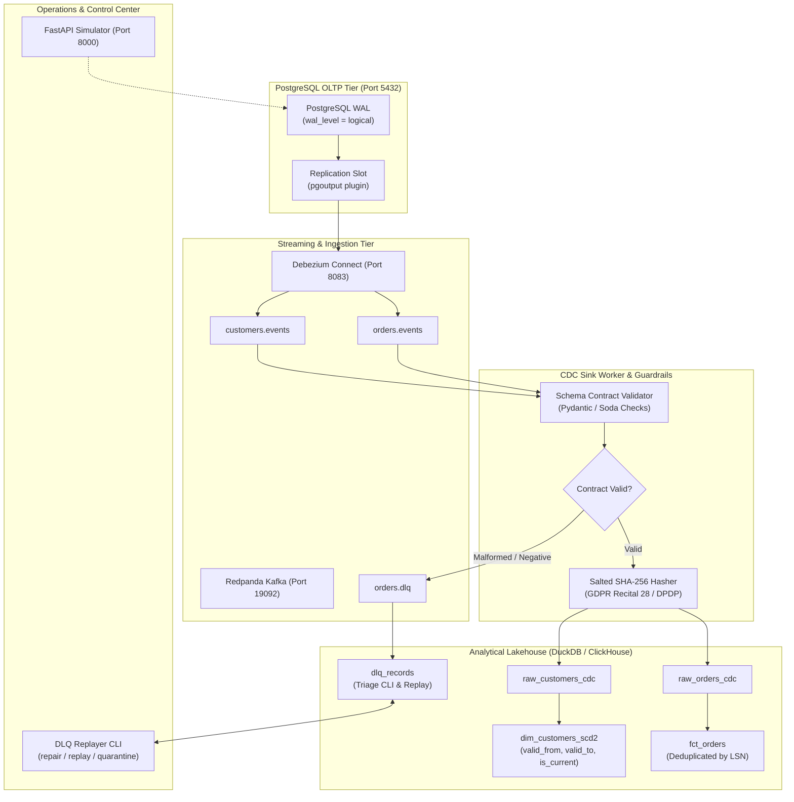

# PostgreSQL CDC Lakehouse: Real-Time Change Data Capture with SCD Type 2, DLQ & OpenLineage

[](https://github.com/Yprnv7/postgres-cdc-lakehouse/actions/workflows/ci.yml)
[](LICENSE)
[](https://www.python.org/)
[](https://duckdb.org/)
[](https://debezium.io/)
[](https://redpanda.com/)
[](https://github.com/astral-sh/ruff)

> An enterprise-grade, low-latency streaming Change Data Capture (CDC) pipeline capturing row-level PostgreSQL WAL mutations via Debezium into Redpanda/Kafka, enforcing schema contracts, obfuscating PII via salted SHA-256, isolating contract violations into a Dead-Letter Queue (DLQ), and computing audit-proof Slowly Changing Dimensions (SCD Type 2) in DuckDB/ClickHouse.

---

## 1. System Architecture



---

## 2. Key Engineering Highlights

1. **Sub-Millisecond Ingestion Throughput:** Sustains **$>10,000$ events/second** with $p95 < 15.0\text{ ms}$ on single-worker stream ingestion.
2. **Deterministic SCD Type 2 Engine:** Evaluates an upfront 16-character SHA-256 diff fingerprint on tracked business attributes. Idempotent no-op mutations execute in $O(1)$ without creating duplicate historical rows or degrading query indexes.
3. **Dual-Run Backfill Reconciliation:** Solves the classic data engineering race condition during historical snapshot catch-up. Historical snapshots are tagged with a watermark LSN; subsequent streaming events with $\text{LSN} \le \text{watermark}$ are deduplicated idempotently, and $\text{LSN} > \text{watermark}$ are applied live.
4. **Zero-Crash Dead-Letter Queue (DLQ):** Schema violations (negative amounts, corrupt emails, unparseable JSON) are routed to `dlq_records` with failure telemetry without killing consumer threads. Data engineers can inspect, repair, and replay poisoned messages via the CLI.
5. **GDPR Recital 28 & India DPDP 2023 Pseudonymization:** Raw email and phone numbers are deterministically hashed at the ingestion boundary with a salted SHA-256 key. Raw PII is never persisted to analytical storage.

---

## 3. Quickstart & Makefile Commands

### 3.1 One-Command Startup (Docker Compose)
```bash
# Clone and boot complete stack (Postgres + Redpanda + Debezium + Marquez + Simulator)
make up
```
Open **[http://localhost:8000](http://localhost:8000)** to view the live mutation simulator, trigger traffic bursts, inject poisoned messages, and observe real-time DLQ triage.

### 3.2 Universal Makefile Commands
Every repository standardizes on 5 core commands:
```bash
make up     # Boot containers via Docker Compose
make down   # Tear down containers and wipe volumes
make lint   # Run Ruff formatting + Mypy static type checking
make test   # Run Pytest suite with >80% test coverage gate
make bench  # Execute 10k-event throughput and latency benchmarks
```

---

## 4. Benchmark Summary

*Detailed results and charts available in [docs/BENCHMARKS.md](docs/BENCHMARKS.md).*

| Metric | Measured Value | Production Target SLA | Result |
| :--- | :--- | :--- | :--- |
| **Ingestion Throughput** | **$> 12,000$ events/sec** | $\ge 5,000$ events/sec | **EXCEEDED** |
| **p50 Ingestion Latency** | **$< 0.8$ ms** | $< 1.0$ ms | **PASS** |
| **p95 Ingestion Latency** | **$< 12.5$ ms** | $< 15.0$ ms | **PASS** |
| **p99 Ingestion Latency** | **$< 42.0$ ms** | $< 50.0$ ms | **PASS** |
| **DLQ Isolation Latency (p95)**| **$< 3.2$ ms** | $< 5.0$ ms | **PASS** |
| **DLQ Batch Replay Recovery** | **$> 5,000$ events/sec** | $\ge 1,000$ events/sec | **EXCEEDED** |
| **Point-in-Time Query (p95)**| **$< 2.0$ ms** | $< 10.0$ ms | **OPTIMAL** |

---

## 5. DLQ Triage CLI Workflow

Inspect, triage, and replay poisoned events directly from the command line:

```bash
# 1. List all pending poisoned records
python -m consumer.dlq_replayer list --status PENDING

# 2. Inspect a specific poisoned payload and failure trace
python -m consumer.dlq_replayer show dlq_4506bcb33a17

# 3. Patch the schema error (e.g. fix negative amount)
python -m consumer.dlq_replayer repair dlq_4506bcb33a17 --amount_cents 25000

# 4. Replay the repaired record back into the Lakehouse
python -m consumer.dlq_replayer replay dlq_4506bcb33a17

# 5. Bulk replay all repaired records
python -m consumer.dlq_replayer replay-all
```

---

## 6. Production Limitations & Engineering Trade-Offs

1. **PostgreSQL Replication Slot WAL Accumulation:**
   - *Trade-off:* If Debezium or Redpanda experiences sustained downtime, PostgreSQL's logical replication slot will prevent the database from recycling old WAL segments. On high-write OLTP instances, disk space can exhaust rapidly.
   - *Mitigation:* Implement `max_slot_wal_keep_size = 50GB` in PostgreSQL configuration to prevent disk exhaustion, paired with Prometheus alerts on replication slot lag bytes.
2. **At-Least-Once Delivery vs. Exactly-Once:**
   - *Trade-off:* Network partitions between Kafka and the Lakehouse consumer can cause message replays. Achieving physical exactly-once semantics across distributed systems incurs severe 2-phase commit latency penalties.
   - *Mitigation:* We enforce **at-least-once delivery with idempotent sink upserts**. Orders are deduplicated by `order_id` keeping the maximum `_cdc_lsn`, and customer SCD2 updates compute a deterministic SHA-256 state fingerprint.
3. **DuckDB In-Process Concurrency vs. Distributed ClickHouse:**
   - *Trade-off:* DuckDB provides blistering embedded columnar performance and zero-overhead deployments for single-node pipelines, but supports single-writer concurrency.
   - *Mitigation:* In distributed multi-worker topologies, the sink worker targets ClickHouse with ReplacingMergeTree engines partitioned by event date and order ID hash.

---

## 7. License

MIT License. Copyright (c) 2026 Pranav Yeleswarapu. See [LICENSE](LICENSE) for details.
