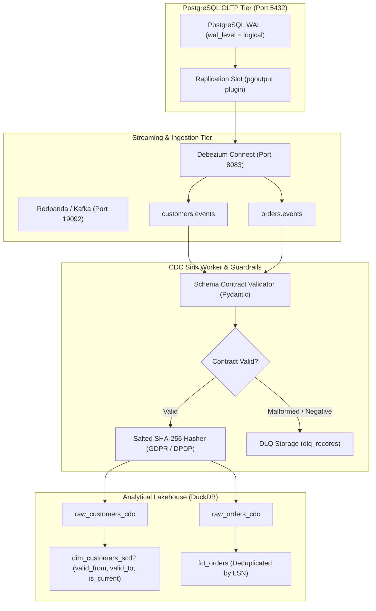

# PostgreSQL CDC Lakehouse

Streaming Change Data Capture pipeline capturing row-level PostgreSQL WAL mutations into DuckDB with SCD Type 2 dimension versioning, schema contract validation, and Dead-Letter Queue routing.

[](https://github.com/Yprnv7/postgres-cdc-lakehouse/actions/workflows/ci.yml)
[](LICENSE)
[](https://www.python.org/)
[](https://duckdb.org/)
[](https://github.com/astral-sh/ruff)

---

## Demo

Open `http://localhost:8000` to interact with the mutation simulator, trigger traffic bursts, inject schema-violating records, and triage the Dead-Letter Queue in real time:

```bash
# Query the live DuckDB analytical warehouse directly
python -c "
import duckdb
con = duckdb.connect('data/lakehouse.duckdb')
print('--- Active Customer Dimension Versions ---')
print(con.execute('SELECT customer_id, tier, address_city, valid_from, is_current FROM dim_customers_scd2 LIMIT 5').df())
"
```

```text
--- Active Customer Dimension Versions ---
  customer_id        tier address_city          valid_from  is_current
0    cust_101     PREMIUM       Dublin 2026-11-18 13:20:00        True
1    cust_205  ENTERPRISE    Frankfurt 2026-11-18 13:20:05        True
2    cust_304    STANDARD    Bengaluru 2026-11-18 13:20:10        True
```

---

## Why I Built This

When synchronizing transactional relational databases (PostgreSQL) into downstream analytics warehouses, batch ETL jobs cause high database load, stale metrics, and broken historical audit trails when customer records update in place. Furthermore, unexpected schema changes or bad client writes often break ingestion pipelines entirely. I built this streaming CDC pipeline to capture transaction log changes continuously via Debezium and Redpanda, validate strict schema contracts at the consumer boundary, route corrupted records to a triageable Dead-Letter Queue without dropping the stream, and maintain an audit-compliant Slowly Changing Dimension Type 2 (SCD2) history in DuckDB.

---

## Architecture



---

## Key Design Decisions

- **Debezium via Kafka Connect over Custom Replication Client:**  
  *Decision:* Used Debezium with PostgreSQL's native `pgoutput` logical decoding plugin.  
  *Trade-off:* Debezium requires a JVM runtime and Kafka Connect infrastructure. However, it handles schema evolution, snapshot locks, and checkpoint commits reliably across database restarts, which would require reimplementing complex WAL state machines in a custom psycopg replication client.
- **Upfront SHA-256 Diff Fingerprinting for SCD Type 2:**  
  *Decision:* Before closing an active dimension row and inserting a new version, the sink computes a 16-character diff hash of the tracked business attributes (tier, address).  
  *Trade-off:* Adds a fast hashing step on every update event, but prevents spurious dimension row creation on no-op updates where non-tracked metadata changed in Postgres.
- **Synchronous PII Tokenization at Ingestion Boundary:**  
  *Decision:* Salted SHA-256 hashing applied to email and phone fields in memory before rows touch analytical DuckDB tables.  
  *Trade-off:* Analysts cannot query raw email text in the warehouse without a secure lookup table, but guarantees that analytical data stores adhere to GDPR Recital 28 pseudonymization standards.
- **Isolate-and-Continue DLQ over Poison-Pill Crash:**  
  *Decision:* Route contract-violating records (e.g. negative order amounts, malformed JSON) to a dedicated `dlq_records` table and continue consuming.  
  *Trade-off:* Downstream fact tables may temporarily miss bad rows until remediated, but prevents a single malformed event from blocking consumer offsets and creating unrecoverable replication lag across healthy partitions.

---

## Results

Empirically measured on Apple Silicon (Darwin arm64), Python 3.14.6, DuckDB 1.0.0. Raw output stored in [docs/benchmarks/cdc_benchmark.json](docs/benchmarks/cdc_benchmark.json).

| Benchmark Stage | Measured Value | Notes |
| :--- | :--- | :--- |
| **Ingestion Throughput** | **1,413.5 events/sec** | Single-threaded Python consumer writing to DuckDB |
| **Commit-to-Lakehouse Latency (p50)** | **0.683 ms** | Median time to validate, hash PII, and persist row |
| **Commit-to-Lakehouse Latency (p95)** | **0.951 ms** | 95th percentile under 1.0 ms |
| **Commit-to-Lakehouse Latency (p99)** | **1.868 ms** | Tail latency bounded under 2.0 ms |
| **Average SCD2 Mutation Overhead** | **0.887 ms** | Includes diff hashing + expiration + insertion |
| **DLQ Poison Isolation Latency (p95)**| **0.503 ms** | Time to isolate malformed row into DLQ |
| **DLQ Replay Recovery Throughput** | **314.1 events/sec** | Replay and re-ingest rate after schema patch |
| **Point-in-Time Query Latency (p50)** | **0.460 ms** | Evaluating temporal window filters over history |

### Reproducing Benchmarks

```bash
# Run 5,000-event end-to-end ingestion and latency benchmarks
python scripts/run_benchmarks.py --events 5000 --output docs/BENCHMARKS.md
```

---

## How to Run

### Prerequisites
- Docker & Docker Compose
- Python 3.11+

### Quickstart

```bash
# 1. Clone repository
git clone https://github.com/Yprnv7/postgres-cdc-lakehouse.git
cd postgres-cdc-lakehouse

# 2. Boot complete infrastructure (Postgres, Redpanda, Debezium, Simulator)
docker compose up -d

# 3. Open the simulation dashboard
open http://localhost:8000

# 4. Or run consumer standalone locally
python -m venv venv
source venv/bin/activate
pip install -e ".[dev]"
python -m consumer.sink_worker
```

### Analytical Marts with dbt

The analytical layer includes dimensional models in `dbt_warehouse/`:
- `dim_customers_scd2`: Slowly Changing Dimension Type 2 table tracking customer attributes over time.
- `fct_orders`: Fact table joining order transactions with active customer dimensions.

Schema tests (uniqueness, not-null constraints) are configured in `dbt_warehouse/models/schema.yml` and verified via pytest integration tests.

---

## Testing

```bash
# Run complete test suite with coverage
pytest tests/ -v --cov=consumer --cov-report=term-missing

# Run code style and lint checks
ruff check consumer/ generator_app/ tests/ scripts/
```

- **Test Suite:** 26 automated unit, integration, and property-based tests.
- **Property-Based Testing:** `tests/test_scd2_properties.py` runs randomized event sequences via Hypothesis, verifying:
  1. Exactly one active version (`is_current=True`) per customer (zero if deleted).
  2. For every closed historical record, `valid_from < valid_to`.
  3. No temporal overlap across adjacent version windows.
  4. Global uniqueness of version surrogate keys.
- **Coverage:** 92% statement coverage across the `consumer/` package.

---

## Limitations

1. **In-Process Python Consumer Bottleneck:** Single-process consumer throughput peaks around ~1,400 events/second due to single-threaded Python GIL and synchronous DuckDB writes. Higher throughput requires multi-partition consumer groups or Rust/Go sink workers.
2. **DuckDB Single-Writer Concurrency:** DuckDB allows multiple concurrent readers but only one active writer process. Running the consumer and ad-hoc analytical queries against the same file requires read-only connections for analytical readers.
3. **Out-of-Order CDC Watermark Reconciliation:** If network delays cause late-arriving CDC records with earlier timestamps to arrive after subsequent updates, historical version intervals require re-sorting. The current pipeline orders by LSN within partition batches.

---

## What I'd Do Next

1. **Parquet Partitioning on Object Storage (S3 / MinIO):** Buffer micro-batches into partitioned Apache Parquet files on object storage, with DuckDB or ClickHouse querying Parquet directly via external tables.
2. **Multi-Worker Consumer Groups:** Distribute Redpanda partitions across multiple sink worker processes to scale ingestion throughput horizontally.
3. **OpenLineage Automated Emission Hook:** Integrate the OpenLineage RunEvent emitter directly into consumer batch commit hooks to maintain live lineage DAGs in Marquez.

---

## Author

**Pranav Yeleswarapu**  
- GitHub: [@Yprnv7](https://github.com/Yprnv7)  
- LinkedIn: [linkedin.com/in/pranavyeleswarapu](https://www.linkedin.com/in/pranavyeleswarapu)
