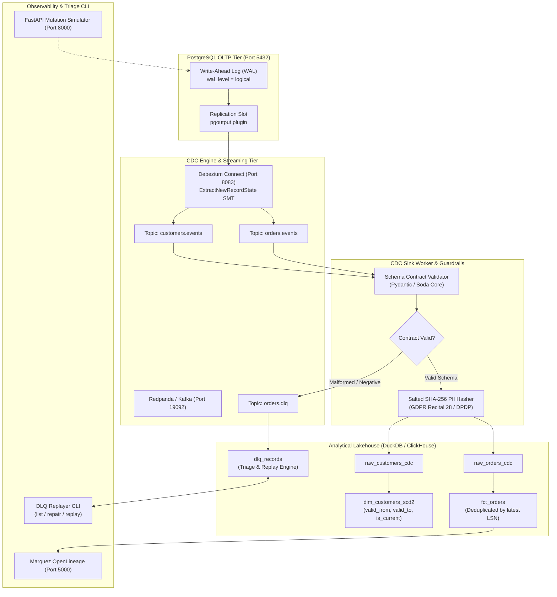

# PostgreSQL CDC Lakehouse: Technical Architecture & System Design

## 1. System Overview & Problem Statement

Modern transactional systems generate continuous row-level state transitions. In enterprise environments (FinTech, e-commerce, banking), querying transactional OLTP databases directly for analytical aggregation or auditing causes lock contention, degraded write latency, and point-in-time state loss. 

When a customer changes their shipping address from *Dublin, Ireland* to *Frankfurt, Germany*, a traditional OLTP `UPDATE` destroys historical state. An analytical query evaluating orders fulfilled during Q1 will incorrectly attribute past orders to the new address.

`postgres-cdc-lakehouse` solves this via real-time **Change Data Capture (CDC)**:
- Captures row-level mutations directly from PostgreSQL's Write-Ahead Log (WAL) using logical decoding (`pgoutput`).
- Streams structured change events through a distributed append-only log (Redpanda/Kafka).
- Enforces data contracts via Pydantic/Soda schemas and isolates poisoned payloads into a Dead-Letter Queue (DLQ).
- Obfuscates personally identifiable information (PII) using salted SHA-256 before analytical storage.
- Automatically computes **Slowly Changing Dimensions (SCD Type 2)** in DuckDB/ClickHouse with temporal validity intervals (`valid_from`, `valid_to`, `is_current`).

---

## 2. High-Level Architectural Flow

---

## 3. Deep Dive: Key Architectural Components

### 3.1 PostgreSQL Logical Replication & LSN Ordering
- PostgreSQL's `wal_level=logical` instructs the storage engine to append full logical row images to the WAL.
- The `pgoutput` logical decoding plugin reads raw binary WAL segments and translates them into structured row operations:
  - `c` (Insert / Create)
  - `u` (Update)
  - `d` (Delete)
  - `r` (Snapshot / Read)
- Each change is assigned a monotonically increasing 64-bit integer called the **Log Sequence Number (LSN)**. The LSN represents the exact physical byte offset in the database WAL, establishing a strict, immutable total ordering across all transactions.

### 3.2 Dual-Run Backfill Reconciliation
When initializing the pipeline on an existing database with millions of rows:
1. **Historical Snapshot Phase:** Reads static tables up to a specific snapshot watermark LSN (`watermark_lsn`).
2. **Streaming Phase:** In parallel, live transactions continue committing to the WAL.
3. **Reconciliation Logic:**
   - Any event received with `lsn <= watermark_lsn` is deduplicated idempotently using the surrogate key or fact table `latest_lsn` check.
   - Any event received with `lsn > watermark_lsn` updates the live state.
   - This eliminates race conditions where live updates are overwritten by an ongoing historical table dump.

### 3.3 Slowly Changing Dimension Type 2 (SCD2) Engine
Rather than running expensive batch dbt snapshot queries every hour, the sink worker computes SCD Type 2 transitions incrementally:
1. Computes a 16-character SHA-256 fingerprint over tracked business attributes:
   $$\text{diff\_hash} = \text{SHA256}(\text{name} \parallel \text{tier} \parallel \text{street} \parallel \text{city} \parallel \text{country})[:16]$$
2. If `diff_hash` matches the current active record, the update is a no-op (idempotent).
3. If `diff_hash` differs:
   - Expire previous active row: set `valid_to = event_timestamp`, `is_current = FALSE`.
   - Insert new row: `valid_from = event_timestamp`, `valid_to = NULL`, `is_current = TRUE`.
4. If operation is delete (`d`):
   - Expire previous active row: set `valid_to = event_timestamp`, `is_current = FALSE`. No new record is inserted.

### 3.4 Dead-Letter Queue (DLQ) & Resilience Guarantees
- In streaming architectures, a single corrupt record (e.g. invalid JSON, schema contract violation, negative order total) must **never crash the consumer process** or halt ingestion across the entire topic partition.
- `CDCSinkWorker` wraps all schema deserialization in safety handlers. Violations are isolated into `dlq_records` containing:
  - `dlq_id`: Unique identifier
  - `original_topic`: Upstream topic name
  - `payload_json`: Verbatim corrupted message
  - `error_reason`: Precise validator error message
  - `retry_count`: Incremented on each triage replay attempt
  - `status`: Lifecycle state (`PENDING`, `REPLAYED`, `QUARANTINED`)
- Data engineers can triage, patch bad records via `dlq_replayer.py repair`, and re-inject them into the pipeline with `dlq_replayer.py replay`.

### 3.5 GDPR Recital 28 & India DPDP 2023 Compliance
- Enterprise customer datasets contain sensitive Personal Identifiable Information (PII) including email addresses and direct phone numbers.
- Under EU GDPR (Recital 28) and India Digital Personal Data Protection (DPDP) Act 2023, analytics environments should utilize pseudonymization.
- The pipeline executes salted SHA-256 hashing at the ingestion boundary:
  $$\text{email\_hash} = \text{SHA256}(\text{SALT} \parallel \text{lowercase\_email})$$
- Raw emails and phone numbers are never persisted into downstream analytical lakehouse storage, guaranteeing zero data leakage in analytics layers.
