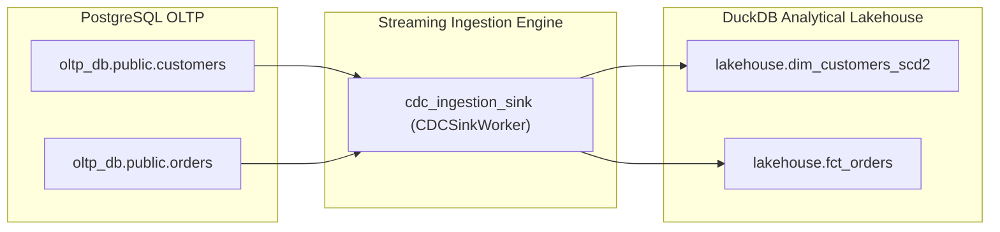

# Data Lineage Architecture with OpenLineage & Marquez

This project implements automated end-to-end data lineage tracking using the [OpenLineage](https://openlineage.io/) standard, emitting dataset lineage graphs directly to [Marquez](https://marquezproject.github.io/marquez/).

---

## 1. Lineage Graph



---

## 2. OpenLineage Event Specification

Every ingestion cycle constructs a standardized `RunEvent` (OpenLineage 1.0.5):

```json
{
  "eventType": "COMPLETE",
  "eventTime": "2026-11-18T13:20:00.000000Z",
  "producer": "https://github.com/Yprnv7/postgres-cdc-lakehouse",
  "schemaURL": "https://openlineage.io/spec/1-0-5/OpenLineage.json",
  "job": {
    "namespace": "postgres_cdc_pipeline",
    "name": "cdc_ingestion_sink",
    "facets": {}
  },
  "run": {
    "runId": "a1b2c3d4-e5f6-7890-abcd-ef1234567890",
    "facets": {
      "nominalTime": {
        "_producer": "https://github.com/Yprnv7/postgres-cdc-lakehouse",
        "_schemaURL": "https://openlineage.io/spec/facets/1-0-0/NominalTimeRunFacet.json",
        "nominalStartTime": "2026-11-18T13:20:00.000000Z"
      }
    }
  },
  "inputs": [
    {
      "namespace": "postgres_oltp",
      "name": "oltp_db.public.customers"
    },
    {
      "namespace": "postgres_oltp",
      "name": "oltp_db.public.orders"
    }
  ],
  "outputs": [
    {
      "namespace": "duckdb_lakehouse",
      "name": "lakehouse.dim_customers_scd2"
    },
    {
      "namespace": "duckdb_lakehouse",
      "name": "lakehouse.fct_orders"
    }
  ]
}
```

---

## 3. Emitting Lineage to Marquez

To emit lineage events to an active Marquez instance:

```bash
# Start Marquez via Docker Compose
docker compose up -d marquez

# Marquez Web UI is available at http://localhost:5000
# API endpoint: http://localhost:5000/api/v1/lineage

# Run worker with MARQUEZ_URL environment variable
export MARQUEZ_URL="http://localhost:5000"
python -m consumer.sink_worker
```
